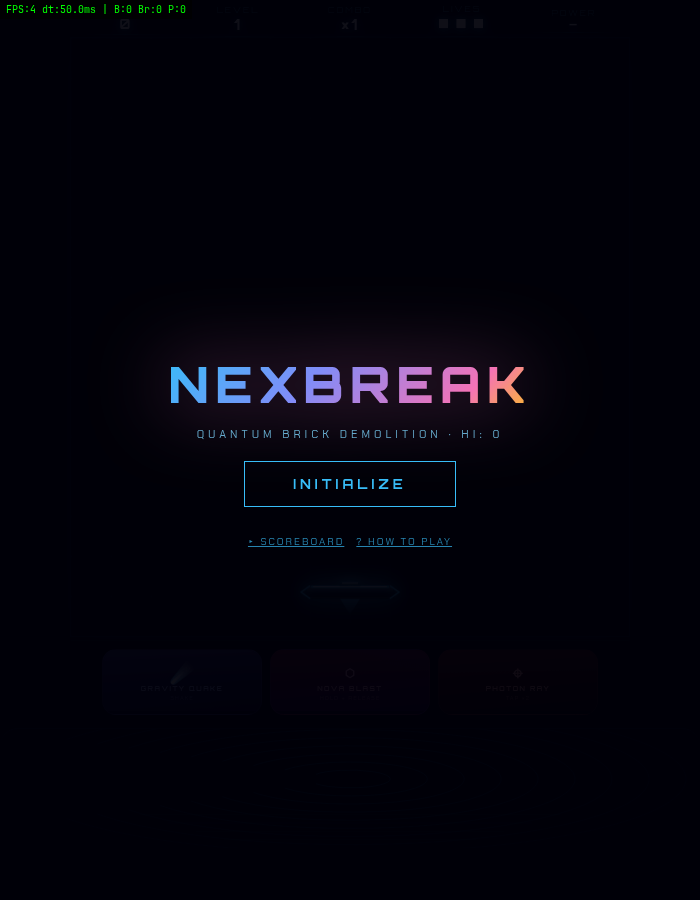

# NexBreak

Quantum brick demolition. A breakout game in a single HTML file, with procedural
music, three weapons and a rhythm-synced DROP mechanic. No build step, no
dependencies.



## Play

Open `html/nexbreak.html` in any modern browser, or serve the folder:

```bash
python3 -m http.server 8000   # then open http://localhost:8000/html/nexbreak.html
```

Move the paddle with the arrow keys, the mouse, or a touch swipe. `P` / `Esc` pauses.

## What's in it

- **Three weapons:** Gravity Quake (`G`, damages random bricks), Nova Blast (hold and
  release `Space` to clear a row), Photon Ray (`L` or double-tap, 10 seconds of lasers).
- **DROP:** every 16 bars of the generated music, a purple warning pulses and you get a
  12-second window of x5 damage and x5 score. Shielded bricks break without bouncing.
- **Powerups:** magnet, multi-ball, shield, wide paddle, slow, laser, warp, explosive ball.
  Plus two penalties: narrow paddle and ghost ball.
- **All audio is synthesized** with the Web Audio API. There are no sample files.
- **Adaptive effects:** nebula, scanlines and glints switch off automatically if the
  frame rate drops below 45 FPS.
- **Local top-10 scoreboard** in `localStorage`, and a built-in how-to-play tutorial.

## iOS wrapper

`NexBreakApp/` is a small SwiftUI app that hosts the game in a `WKWebView`, with
haptics and shake-to-trigger-Gravity-Quake. Requires iOS 16+.

```bash
cd NexBreakApp
xcodebuild build -project NexBreakApp.xcodeproj -scheme NexBreakApp \
  -configuration Release -destination "generic/platform=iOS" \
  CODE_SIGNING_ALLOWED=NO
```

The project is unsigned; sign it with your own team to install on a device. If you
change `html/nexbreak.html`, copy it to `NexBreakApp/NexBreakApp/nexbreak.html` too.

## Notes

Fonts load from Google Fonts. Everything else is local.

## License

MIT, see [LICENSE](LICENSE).
